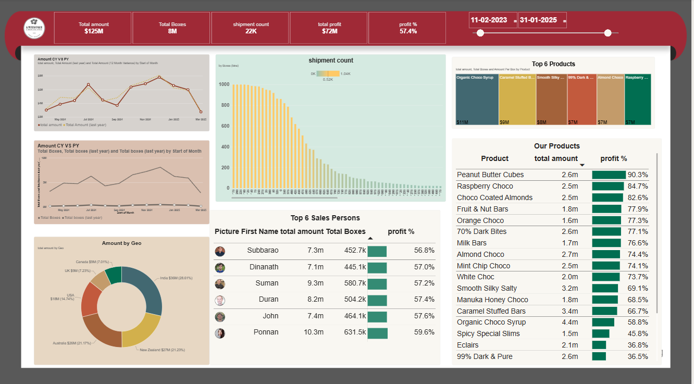

# Chocolate Shipments Dashboard

An interactive **Power BI** dashboard that analysis 25,000+ chocolate shipments (Jan 2023 – Mar 2025) across 22 products, 25 sales people and 6 countries. It shows sales, profit, boxes shipped and year-over-year trends in one place.

---

## Dashboard Preview



---

## Business Questions

- How much revenue and profit are we making, and how does it compare with last year?
- Which products are the most profitable, and which ones earn the lowest margin?
- Which countries and sales people drive the most sales?
- How large is a typical shipment, and how are shipment sizes distributed?

---

## Dataset

| Table | Description |
|---|---|
| **Shipments** | 25,076 rows: shipment ID, ship date, amount, boxes, order status (Delivered, Shipped, Placed, Cancelled) |
| **Products** | 22 products with category and cost per box |
| **Locations** | 6 countries (India, USA, UK, Canada, Australia, New Zealand) with region |
| **People** | 25 sales people with team and photo |
| **Calendar** | Date table used for time-based measures |

The Shipments table is the fact table and connects to the other tables through product, location and sales-person IDs (star schema).

---

## Key Measures (DAX)

- Total Amount
- Total Boxes
- Shipment Count
- Total Profit
- Profit %
- Amount Per Box
- Total Amount (Last Year)
- Total Amount (12 Month Variance)

---

## Dashboard Features

- **KPI cards:** total amount, total boxes, shipment count, total profit and profit %
- **Year-over-year line charts** for amount and boxes
- **Shipment size distribution** (boxes histogram)
- **Top 6 products** (treemap) and a full product list with profit %
- **Top 6 sales people** with photos, amount, boxes and profit %
- **Sales by country** (donut chart)
- **Date range slicer** to filter every visual

---

## Key Insights

- India is the largest market, at about 28.6% of total sales.
- Profit % varies a lot by product, from about 90% (Peanut Butter Cubes) to about 36% (99% Dark & Pure).
- The top 6 sales people have similar profit margins (about 57–60%), so differences come mainly from sales volume.

---

## Tools Used

- Power BI Desktop (Power Query, data modelling, DAX)
- Microsoft Excel (source data)

---

## How to Use

1. Clone or download this repository.
2. Open `Chocolate_Shipments_Dashboard.pbix` in **Power BI Desktop**.
3. If Power BI asks for the data source, point it to `Chocolate_Shipments_Data.xlsx` (**Home → Transform data → Data source settings**).
4. Use the date slicer to explore different periods.

---

## Project Structure

```
├── Chocolate_Shipments_Dashboard.pbix   # Power BI report
├── Chocolate_Shipments_Data.xlsx        # Source data
├── images/
│   └── dashboard.png                    # Dashboard screenshot
└── README.md
```

## Author

**Vedavalli Guntuku**  
Data Analyst  

🔗 [GitHub](https://github.com/vedavalliguntuku/chocolate-shipments-Power-BI-dashboard))  
